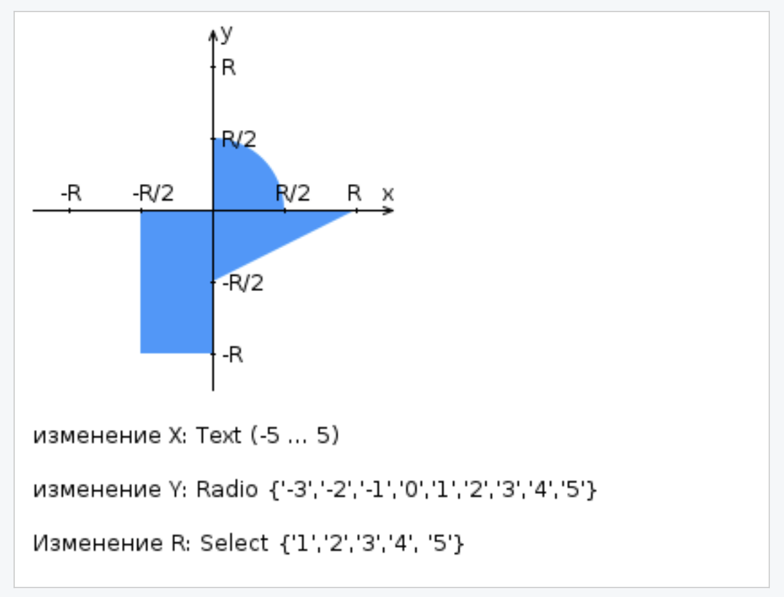

# Лабораторная работа #2

## Вариант 449652

**Внимание! У разных вариантов разный текст задания!**



Доработать ЛР №1 и разработать FastCGI сервер на языке Java, определяющий попадание точки на координатной плоскости в заданную область, и создать HTML-страницу, которая формирует данные для отправки их на обработку этому серверу.

Параметр R и координаты точки должны передаваться серверу посредством HTTP-запроса. Сервер должен выполнять валидацию данных и возвращать HTML-страницу с таблицей, содержащей полученные параметры и результат вычислений — факт попадания или непопадания точки в область (допускается в ответе сервера возвращать json строку, вместо html-страницы). Предыдущие результаты должны сохраняться между запросами и отображаться в таблице.

Кроме того, ответ должен содержать данные о текущем времени и времени работы скрипта.

**Комментарии по выполнению ЛР:**

- Требуется поднять Apache httpd веб-сервер от лица своего пользователя на гелиосе (шаблон файла конфигурации доступен для скачивания наверху страницы)
- Веб-сервер должен заниматься обслуживанием статического контента (html, css, js) и перенаправлять запросы за динамическим контентом к FastCGI серверу
- FastCGI сервер требуется реализовать на языке Java (полезная библиотека в помощь в виде jar архива доступна для скачивания наверху страницы) и поднять также на гелиосе
- **Путем обращений из JavaScript к FastCGI серверу требуется показать понимание принципа AJAX**

**Разработанная HTML-страница должна удовлетворять следующим требованиям (дополнительными, по отношению к ЛР №1, различаются по варианту):**

- Данные формы должны передаваться на обработку посредством GET-запроса.

---

## Запуск

1. Возьмите `fastcgi-lib.jar` из материалов лабораторной работы и поместите его в каталог `lab2`.
2. Поместите `src/index.html` и `src/script.js` в корень сайта Apache, а `resources/background.jpeg` — в подпапку `resources` этого корня.
3. Сохраните шаблон `httpd-helios.conf.example` как `~/httpd-root/conf/httpd.conf` и укажите свой логин, порт Apache и порт FastCGI. Для путей из шаблона нужны каталоги `~/httpd-root/htdocs` и `~/httpd-root/mutex-dir`. Apache передаёт запросы к `/check` приложению Java.
4. Соберите и запустите Java-приложение из каталога `lab2`. В команде запуска укажите тот же порт FastCGI, что и в настройках Apache.

```sh
javac -encoding UTF-8 -cp fastcgi-lib.jar -d out src/Main.java
java -DFCGI_PORT=9000 -cp "out:fastcgi-lib.jar" Main
```

В другом терминале запустите Apache.

```sh
httpd -f "$HOME/httpd-root/conf/httpd.conf" -k start
```
